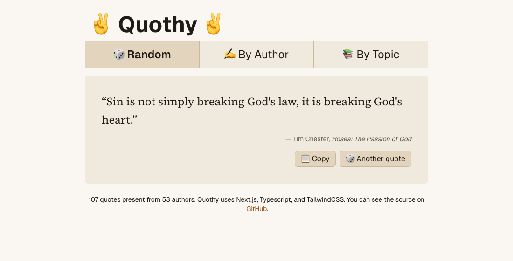

# ✌ Quothy ✌

[](https://github.com/MarkNenadov/quothy/actions/workflows/ci.yml)

Quotes from my reading, browsable at random, by author, or by topic, and searchable. Every author, topic
and quote has its own shareable page with a link-preview card, like
[/topics/moths](https://quotes.marknenadov.com/topics/moths).

**Live:** https://quotes.marknenadov.com/

<picture>
  <source media="(prefers-color-scheme: dark)" srcset="docs/screenshot-dark.png">
  
</picture>

## Stack

- [Next.js](https://nextjs.org) 16 App Router: the random quote renders per request, and every author and topic page
  is pre-built, so the quote data never ships in client JavaScript
- React 19 and TypeScript
- Tailwind CSS 4 with light and dark colour tokens
- Jest and Testing Library
- Bun for installs and scripts, deployed on Vercel

## Getting started

```bash
bun install
bun run dev
```

Open http://localhost:3000.

| Script              | What it does          |
| ------------------- | --------------------- |
| `bun run dev`       | Start the dev server  |
| `bun run test`      | Run the test suite    |
| `bun run typecheck` | Type-check with `tsc` |
| `bun run lint`      | Lint with ESLint      |
| `bun run format`    | Format with Prettier  |
| `bun run build`     | Production build      |

CI checks formatting and runs typecheck, lint, tests and build on every push and pull request.

## Adding a quote

Quotes live in [`src/data/quoteData.ts`](src/data/quoteData.ts). Append an entry:

```ts
{
  id: "a1b2c3",
  quote: "The quote, verbatim.",
  book: {
    author: "Author Name",
    title: "Book Title",
  },
  tags: ["existing-tag", "another-tag"],
},
```

The data has its own tests ([`quoteData.test.ts`](src/data/quoteData.test.ts)), so `bun run test` catches:

- a book title credited to more than one author
- two authors whose names map to the same page URL
- tags that aren't kebab-case
- duplicate quotes or quotes with no tags
- missing, malformed or duplicate ids (six lowercase letters or digits, never changed once published)
- leading or trailing whitespace

In [Claude Code](https://claude.com/claude-code), `/add-quote` does all of this for you: it matches the
existing spelling of the book and author, suggests tags already in use, inserts the entry, and runs the
data tests.

## Project structure

```
src/
  app/          Next.js routes, layout, global styles, icons
  components/   UI components, each with a colocated test
  data/         The quotes and their validation tests
  lib/          Pure helpers (e.g. picking a random quote)
  models/       Quote and Book types
```

## How I build this with LLMs

I build Quothy by pair-programming with [Claude Code](https://claude.com/claude-code); commits it helped
write carry a `Co-Authored-By` trailer. A few things keep that collaboration honest:

- **[`CLAUDE.md`](CLAUDE.md)** gives the agent the project's commands and conventions, so it works the way
  I would.
- **Tests first.** New features and bug fixes start with a failing test.
- **The data is tested, not just the code.** The checks above have caught real mistakes (a misattributed
  author, a stray non-breaking space).
- **CI is the gate.** Nothing is "done" until typecheck, lint, tests and build pass.
- **Repeatable tasks become skills.** [`/add-quote`](.claude/skills/add-quote/SKILL.md) turns the most
  common change into one command.
